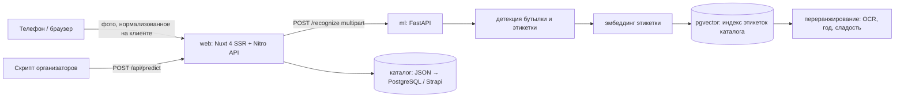

# Архитектура

## Сервисы

**web** (`web/`, Nuxt 4). SSR-страницы в стиле портала и API с теми же путями и форматом, что у vino-svoe.ru (`/api/wines…`). Каталог читается через `server/utils/catalog.ts` — единственное место, которое меняется при переходе с JSON-выгрузки на PostgreSQL или Strapi. Web не знает, как устроена модель: он зовёт сервис распознавания по HTTP-контракту и дорисовывает то, что после распознавания (карточка, аналоги, сомелье).

**ml** (`ml/`, FastAPI). Отдельный процесс и контейнер, масштабируется независимо (GPU/CPU). Сейчас внутри детерминированная заглушка с финальным контрактом. Конвейер `Pipeline` состоит из трёх заменяемых частей: `Detector`, `Matcher`, `LabelReader`, контракт при замене не меняется. Swagger: `/docs`.

## Поток сканирования

1. Клиент (`useScan`) поворачивает фото по EXIF, уменьшает до 1600 px и кодирует в JPEG 0.9: 150–400 КБ вместо 3–8 МБ, что важно для мобильной сети.
2. `POST /api/wines/search-by-photo` → `POST {ML}/recognize`. RF-DETR-Seg Small находит все бутылки (COCO bottle), у каждой свой матч: `detection.bottles[] = {bbox, label_bbox, center, source, match{status, slug, confidence, read}}`, бутылки слева направо, `primary` — главная (крупная и ближе к центру). Её матч продублирован наверху ответа (`status/slug/confidence/read`) — это же отдаёт `/predict`. Если бутылок не нашлось (крупный план этикетки), ищем по всему кадру (`source: "full_image"`).
3. Web добавляет мини-карточку каждой найденной бутылке, полную карточку и аналоги — главной (при `found` — вина того же стиля из других виноделен, при `not_found` — в стиле прочитанного с этикетки или топ-5).
4. Экран `/scan/result`. Какие бутылки отметить, решает сайт (`server/utils/prominence.ts`): заметность = площадь × (1 − 0.5 · удалённость от центра). Если первая бутылка заметнее второй в 2+ раза — отмечается только она: точка на бутылке и чистая мини-карточка под фото. Иначе отмечается передний ряд (заметность ≥ 40 % и высота ≥ 60 % от лучшей, до 6 бутылок): цветные кружки с номерами на бутылках и те же кружки у карточек в колонке справа. Мелкие бутылки сзади не отмечаются, линий нет. Экрана выбора «какое из вин ваше» нет (по ТЗ), confidence в интерфейсе не показывается.
5. Карточка `/wines/:slug?from=scan`: сверка прочитанного с каталогом (например, «на этикетке полусладкое, в каталоге сухое» — частая ошибка при покупке), сохранение с урожаем с этикетки.

## Живой AR-режим (`/scan/ar`)

Всё в реальном времени, на телефоне (`app/pages/scan/ar.vue`, геометрия — `app/utils/arRender.ts`, трекинг этикеток — `app/utils/arLabels.ts` + `arPlanar.ts`):

- **Распознавание.** Кадры с камеры уходят в `POST /api/wines/ar-frame` (тот же `/recognize`, облегчённый ответ: боксы, маски RF-DETR-Seg, совпадения и компактные карточки вин) без ожидания ответа, до двух запросов одновременно.
- **Видоискатель с задержкой ≤ 0,3 с** (`?delay=0…300`). Каждый кадр буферизуется и попадает на экран и в трекер на DELAY мс позже. Ответ сервера, пришедший до показа своего кадра, применяется ровно на нём; более поздний переносится трекером.
- **Карточки на бутылках.** Портретная карточка «Своё вино» на каждой отслеживаемой этикетке — 3D-прямоугольник: одна модель камеры на кадр, «вверх» по осям бутылок из масок, на одной полке карточки стоят на одном уровне и одной ширины. До ответа — «AR · на этикетке», вне каталога — «Нет в каталоге».
- **Панель одного вина.** Если узнанная бутылка одна в кадре или её бокс в 1,8+ раза шире каждой другой бутылки из ответа детектора, 0,5 с подряд, карточка вырастает в панель (стиль, регион на карте, вкус, сочетания, подача). Панель стоит рядом с бутылкой, высотой с бутылку, повёрнута к зрителю.
- **Выбор вин.** Найденные вина собираются в плашке «Отсканировано: N» (`components/ArShelfSheet.vue`). Тап открывает те же сетку, «Фильтры» и «Рекомендации», что выдача фото полки. После закрытия рекомендованные вина помечаются на бутылках, не подходящие под фильтры приглушаются.
- **Поворот телефона** не перезапускает камеру: картинка и AR по гравитации, кнопки остаются на корпусе.
- Без распознавания (`?id=0`) — только трекинг этикеток через `POST /api/ar/detect`.

## Контракт для организаторов

`POST /api/predict` (или напрямую `POST {ML}/predict`) принимает multipart `file`/`image` или сырое тело `image/*` и отвечает плоским `{"slug": "wine-slug"}`, а если вина нет — `{"slug": ""}`.

## Модель (подключается в `ml/`)

По результатам экспериментов (`wine_seg/`):
- **Детекция.** RF-DETR-Seg Small: бутылка и фронтальная этикетка ниже линии плеч. Кроп этикетки с небольшим фоном матчится лучше, чем вырезка без фона.
- **Эмбеддинги.** SigLIP 2 (so400m) по кропу этикетки. Индекс — фото каталога плюс размеченные кадры реальных фото, привязанные к slug. Поиск — pgvector (HNSW, cosine).
- **Переранжирование топ-K.** OCR названия и года, классификация цвета и сладости: разводит линейки одного производителя с похожим дизайном (сухое и полусладкое, разные урожаи).
- **Порог «нет в каталоге».** По `top1` и отрыву `margin`; ниже порога — `not_found` с аналогами.
- **Текущие замеры без дообучения**, фото → каталог из 2105 вин: R@1 0.67, R@5 0.93. Дообучение на группах видео (сплит по времени записи) — следующий шаг.

## Скорость (SLA < 3 с)

| Этап | Бюджет |
|---|---|
| загрузка 150–400 КБ по мобильной сети | 0.3–1 с |
| детекция + эмбеддинг на GPU | ~150 мс (на CPU ~0.8 с) |
| pgvector top-50 по ~10⁴ векторов | < 10 мс |
| OCR и переранжирование | ~200 мс |
| сборка карточки и аналогов в web | < 20 мс |

Web ждёт ML не дольше `mlTimeoutMs` (8 с) и отвечает 502 с понятным сообщением. Заглушка отвечает за 10–30 мс.

## Функции после поиска (удержание)

- **Цифровой сомелье.** Два тапа: к чему подаёте и какой повод. Ответ — вердикт по этому вину на данных винодельни о сочетаниях и подборка из каталога со ссылкой «Все N вин» в отфильтрованный каталог.
- **Аналоги других виноделен.** Цвет, сладость, общие сорта, регион, рейтинг, не больше двух вин от одной винодельни. Закрывает сценарии «нет в магазине» и «попробовать похожее».
- **Личный кабинет без регистрации** (`/my`, localStorage).
  - Живой AR (`/scan/ar`) распознаёт вина по умолчанию (`?id=0` — только трекинг этикеток): кадр сопоставляется по 6 самым крупным бутылкам переднего ряда (`max_bottles`), фото полки — до 32.
  - «Коллекция» — оценённые вина. Попасть в неё можно только через сканер: оценка доступна для вина, распознанного на фото или в AR (история сканов); карточка, открытая из каталога, предлагает отсканировать бутылку. Урожай с этикетки сохраняется вместе с оценкой.
  - «Мой вкус» — анкета для тех, кто не разбирается в вине (`shared/taste.ts`): какое вино берёте, насколько сладкое (если «не знаю» — сахар в чае, с половинным весом), какие известные вина нравились (Киндзмараули, Асти, брют…), с чем пьёте, лёгкое или насыщенное. Профиль — цвет, сладость по шкале 0–3, игристое, блюда, тело; оценки 4–5 из коллекции тянут его к своему стилю. Используются только данные, которые есть у каждого вина каталога; процентов совпадения нет.
  - На карточке вина — строка «Для вас» («суше, чем вы обычно любите», «подходит к мясу»), в кабинете — «Вина в вашем стиле» (`POST /api/wines/for-taste`), на фото полки первыми идут вина, похожие на оценённые на 4–5.
  - История сканов с миниатюрами фото.

## Данные

`web/scripts/build_catalog.py` выгружает каталог портала в `data/catalog.json` (список), `data/wines/<slug>.json` (карточки), `data/filters.json` и `public/img/wines/*.webp`. В продакшене: PostgreSQL (каталог, векторы в pgvector) и Strapi (редактура карточек). Web читает каталог через `server/utils/catalog.ts`, ML — индекс из той же БД.
